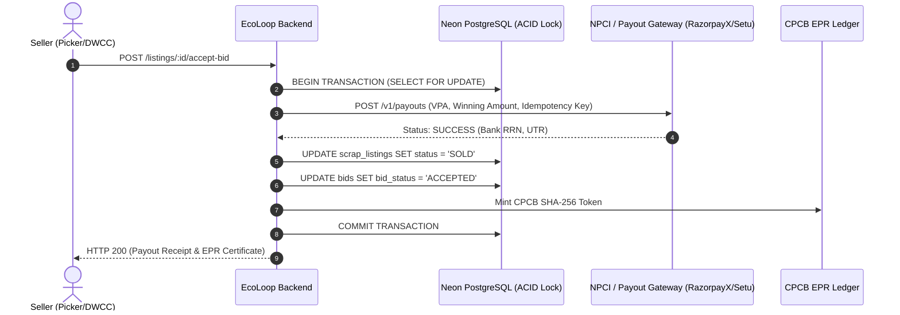

# EcoLoop: Seller UPI Onboarding & Real-Time Settlement Architecture

## Overview
This architectural specification details the future enhancement roadmap for **Seller UPI Onboarding**, **Escrow Liquidation**, and **Automated Settlement Execution** in EcoLoop. It translates the informal waste sector's real-world constraints (Jan Dhan accounts, digital literacy variations, high-value bulk transactions) into an enterprise-grade fintech integration layer.

---

## 1. Onboarding & VPA Registration Workflow

### 1.1 First-Time Seller Registration
During account registration (`POST /api/v1/auth/register` or initial profile onboarding):
- Role: `Picker` or `DWCC` (Material Recovery Facility / Aggregator).
- Primary identification: 10-digit mobile number (`+91...`).
- Settlement destination: Unified Payments Interface (UPI) Virtual Payment Address (VPA).

### 1.2 "Penny-Drop" Reverse Verification (NPCI Bank Validation)
To eliminate catastrophic typo risk on high-value scrap lots (e.g. ₹50,000–₹5,00,000), registration will integrate an automated Penny-Drop verification engine (via Setu, RazorpayX, or Cashfree):
1. **Trigger**: When the seller types or pastes a VPA (e.g., `ramesh.waste@upi`).
2. **Execution**: A ₹1.00 micro-deposit is sent to the VPA via NPCI instant switch.
3. **Validation Payload**: The banking network returns:
   - `account_exists`: `true`
   - `registered_name`: e.g., `"RAMESH KUMAR"`
   - `bank_name`: e.g., `"STATE BANK OF INDIA"`
   - `ifsc_prefix`: `"SBIN000..."`
4. **Seller Confirmation**: The UI displays:
   > *"Bank Confirmed: Account registered to **RAMESH KUMAR (State Bank of India)**. Confirm settlement destination?"*
5. **State**: The VPA is tagged as `VERIFIED` in `users.upi_vpa_status`.

### 1.3 Zero-Typing Assisted Capture
For informal waste collectors with limited alphanumeric typing comfort:
- **Camera Standee QR Scan**: Uses device camera (`html5-qrcode` / WebRTC) to scan their physical PhonePe/GPay/Paytm QR standee; regex parses `upi://pay?pa={vpa}&pn={name}`.
- **NPCI UPI Number Mapper**: Defaults suggestion to `[mobile_number]@upi` or prompts the seller to verify their 10-digit phone number as their UPI ID.

---

## 2. Settlement & Payout Engine

### 2.1 Trigger Condition
Payout is executed within the **atomic auction finalization transaction** (`POST /api/v1/listings/:id/accept-bid`):


### 2.2 Split Settlement Breakdown
Upon auction acceptance for amount $A$:
- **Seller Net Proceeds**: $98.5\% \times A$ (Instant transfer to `seller.upi_vpa`).
- **EcoLoop Marketplace Commission**: $1.0\% \times A$ (Retained in platform settlement pool).
- **Waste Collector Micro-Welfare Reserve**: $0.5\% \times A$ (Accumulated for quarterly healthcare/ESI micro-insurance benefits for registered informal pickers).

---

## 3. Financial Inclusion: Shared Custody for Informal Pickers

For pickers without active personal bank accounts or smartphones:
1. **Self-Help Group (SHG) / DWCC Hub Proxy**:
   - The seller registers under a verified collective (e.g. *Hasiru Dala*, *Chintan*, or municipal ward hub).
   - The payout lands in the collective's audited escrow account.
2. **Instant Receipt & Passbook Voucher**:
   - EcoLoop generates an immutable printable/downloadable voucher with QR code, Bank Reference Number (RRN), gross weight, material grade, and net cash entitlement.

---

## 4. Multi-Lingual WhatsApp & Voice SMS Notifications

Immediately following successful payout:
- **WhatsApp Webhook**: Automated invoice and CPCB EPR credit summary delivered to seller's mobile number.
- **IVR / Audio SMS Alert**: Local-language automated voice note (Hindi, Kannada, Marathi, Tamil, Telugu):
  > *"Namaste Ramesh-ji, EcoLoop dwara aapke SBI bank khate mein PET Scrap Lot #1042 ke ₹37,500 jama kar diye gaye hain. RRN: 310829104820."*

---

## 5. Proposed Database Schema Additions (For Future Migration)

```sql
-- Schema extensions for Phase 3 Payout Integration
ALTER TABLE users ADD COLUMN IF NOT EXISTS upi_vpa_status VARCHAR(20) DEFAULT 'UNVERIFIED' 
    CHECK (upi_vpa_status IN ('UNVERIFIED', 'VERIFIED', 'FAILED'));
ALTER TABLE users ADD COLUMN IF NOT EXISTS upi_bank_account_holder VARCHAR(255);
ALTER TABLE users ADD COLUMN IF NOT EXISTS upi_verified_at TIMESTAMP WITH TIME ZONE;

CREATE TABLE IF NOT EXISTS payouts (
    payout_id UUID PRIMARY KEY DEFAULT gen_random_uuid(),
    listing_id UUID NOT NULL REFERENCES scrap_listings(listing_id) ON DELETE CASCADE,
    seller_id UUID NOT NULL REFERENCES users(user_id) ON DELETE CASCADE,
    payee_vpa VARCHAR(255) NOT NULL,
    gross_amount NUMERIC(10, 2) NOT NULL,
    seller_net_amount NUMERIC(10, 2) NOT NULL,
    platform_fee NUMERIC(10, 2) NOT NULL,
    welfare_levy NUMERIC(10, 2) NOT NULL,
    gateway_transaction_id VARCHAR(100) UNIQUE NOT NULL,
    bank_rrn VARCHAR(50) NOT NULL,
    status VARCHAR(30) NOT NULL DEFAULT 'SUCCESS'
        CHECK (status IN ('PENDING', 'SUCCESS', 'FAILED', 'REVERSED')),
    created_at TIMESTAMP WITH TIME ZONE DEFAULT NOW()
);

CREATE INDEX IF NOT EXISTS idx_payouts_seller ON payouts(seller_id);
CREATE INDEX IF NOT EXISTS idx_payouts_listing ON payouts(listing_id);
CREATE INDEX IF NOT EXISTS idx_payouts_gateway_txn ON payouts(gateway_transaction_id);
```

---

## 6. Implementation Checklist (When Triggered)
- [ ] Connect Payment Gateway Sandbox (Cashfree Payouts / RazorpayX).
- [ ] Implement VPA format verification regex & test penny-drop endpoint (`POST /api/v1/users/verify-vpa`).
- [ ] Add Camera QR Scanner modal to registration form.
- [ ] Create `payouts` table migration and link with `acceptBid` controller.
- [ ] Integrate WhatsApp Business API template for instant settlement confirmation.
